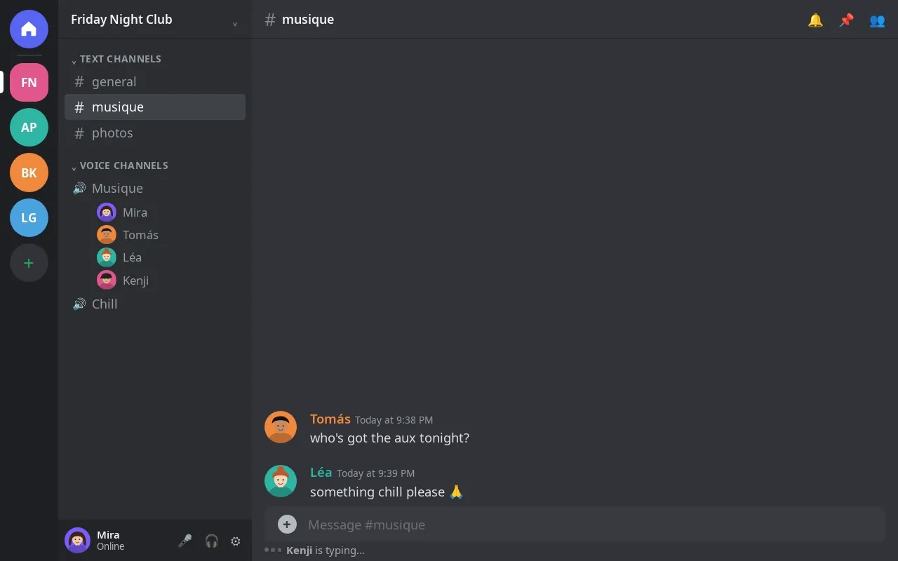

# DJ Snake

<p align="center">
  <a href="https://theroxat.github.io/DJ_Snake/demo/"></a>
  <br>
  <sub><a href="docs/screenshots/clip-page.png">Static screenshot</a> · <a href="https://theroxat.github.io/DJ_Snake/demo/"><b>Try the live demo</b></a> (real CC-BY footage) · <a href="https://theroxat.github.io/DJ_Snake/">Project page</a></sub>
</p>

A self-hosted Discord music bot that downloads YouTube audio and video, plays it in voice channels with an independent queue per server, and serves a live "clip page" with a synced muted video and web controls. It is meant to run on your own machine for your own server.

[](https://github.com/Theroxat/DJ_Snake/actions/workflows/ci.yml)
[](https://github.com/Theroxat/DJ_Snake/releases)
[](https://github.com/Theroxat/DJ_Snake/pkgs/container/dj_snake)
[](LICENSE)


## Features

- YouTube URLs and playlists. There is no search. Tracks are fully downloaded before they play (no streaming).
- Independent queue per server.
- Live clip page: muted video synced with the audio, plus web controls (next, previous, pause, resume, seek, jump, remove, reorder, add).
- Automix, always on: SponsorBlock `music_offtopic` segments are cut, loudness is normalised to -14 LUFS, leading and trailing silence is trimmed, and tracks fade in and out.
- Optional crossfade between tracks.
- Seven clip page themes (Arcade, Minimal, Nuit, Vinyle, Club, Terminal and a custom one with your colors, community name and logo). Server admins set the default, and each viewer can pick their own.
- One live status message per session, edited in place instead of spamming the channel.
- Radio/mix links ask whether to play the single track or the whole playlist.
- yt-dlp upgrades itself on start, and a PO token sidecar handles YouTube's bot check.

## Quick start (Docker Compose)

1. In the [Discord Developer Portal](https://discord.com/developers/applications), create an application and add a bot.
2. Under Bot, enable the **Message Content Intent**. It is the only privileged intent needed.
3. Invite the bot with the `bot` scope and these permissions: View Channels, Send Messages, Read Message History, Add Reactions, Connect, Speak.
4. Deploy, with the prebuilt image (recommended):

```bash
git clone https://github.com/Theroxat/DJ_Snake.git
cd DJ_Snake
cp .env.example .env        # set DISCORD_TOKEN
docker compose pull && docker compose up -d
docker compose logs -f dj-snake
```

   Or build from source (for local changes):

```bash
docker compose up -d --build
```

   The prebuilt image is `ghcr.io/theroxat/dj_snake:latest`; the compose file also keeps `build: .` for local builds.

5. Join a voice channel and send `!play https://www.youtube.com/watch?v=...`.

## Commands

The prefix is `!` by default (`COMMAND_PREFIX`).

| Command | Description |
| --- | --- |
| `!play <url>` | Join your voice channel and queue a YouTube video or playlist. |
| `!list` | Show the current queue. |
| `!next` | Skip to the next track. |
| `!pause` / `!resume` | Pause or resume playback. |
| `!seek <pos>` | Jump to a position in the track, in seconds or `mm:ss`, as the clip page shows it. |
| `!crossfade on\|off` | Enable or disable crossfade for this session (off by default). |
| `!stop` | Stop, clear the queue, delete the downloaded files and leave voice. |
| `!reset` | Force a clean voice reconnect. |
| `!theme [preset\|reset\|edit]` | Show or set the clip page's default theme for the server. `edit` DMs you a private editor link. Needs the Manage Server permission. |

## Clip page

When the bot joins voice it posts a link such as `https://dj.example.com/<session>` and keeps a status message in that text channel. The page shows the video of the current track, the queue, and a progress bar, and lets you skip, go back, pause, resume, seek, play a queued track now, remove, reorder and add YouTube URLs.

A session belongs to the server and survives the bot leaving voice. It expires after `SESSION_IDLE_HOURS` (6 by default) without playback, voice presence, commands or web actions; its files are then deleted.

**Exposing it.** The container listens on `WEB_PORT`. Compose publishes it on `WEB_BIND`, which defaults to `127.0.0.1` (this machine only). To reach it from elsewhere, put a reverse proxy or a tunnel in front, and set `PUBLIC_BASE_URL` to the public address so the posted link is correct.

```
# Caddyfile
dj.example.com {
    reverse_proxy 127.0.0.1:47823
}
```

```bash
# or a Cloudflare Tunnel, then PUBLIC_BASE_URL=https://dj.example.com
cloudflared tunnel --url http://127.0.0.1:47823
```

Anyone who has the link can control the queue. Treat it as a secret and share it only with people you trust.

### Themes


The clip page has six preset themes (`arcade`, the default look, plus `minimal`, `nuit`, `vinyle`, `club` and `terminal`) and a custom one, `perso`, built from three colors (background, text, accent) on top of a preset's fonts and shapes. Viewers can switch theme for themselves with the palette button in the page header; their choice stays in their browser.

Members with the **Manage Server** permission set the server's default:

- `!theme` shows the current theme and the presets, `!theme <preset>` sets it, and `!theme reset` goes back to `WEB_THEME` (and drops the custom colors, name and logo).
- `!theme edit` sends you, by direct message, a private link to the page's theme editor. It is valid for 30 minutes. There you can pick the default theme, build a `perso` palette, set a community name shown instead of "DJ Snake", and upload a logo (PNG, JPEG, WebP or GIF, 512 KB max). If the server has no live session, one is opened without joining voice.

Themes and logos are stored in `DATA_DIR` (`./data` with Compose), so they survive restarts and rebuilds. The container runs as UID 1000, which must be able to write that directory.

## Configuration

Set these in `.env` (see `.env.example`).

| Variable | Default | Meaning |
| --- | --- | --- |
| `DISCORD_TOKEN` | none (required) | Bot token. A `token` file is a fallback. |
| `COMMAND_PREFIX` | `!` | Prefix for text commands. |
| `MAX_PLAYLIST_SIZE` | `30` | Maximum tracks loaded from a playlist. |
| `MEDIA_FORMAT` | max 720p H.264 + m4a | yt-dlp format selector. |
| `TEMP_DIR` | fresh temp directory | Where downloaded tracks are stored. |
| `POT_BASE_URL` | `http://pot-provider:4416` | PO token provider URL (matches Compose). |
| `WEB_PORT` | `47823` | Clip page port, in the container and on the host. |
| `WEB_BIND` | `127.0.0.1` | Host IP the port is published on (Compose only). |
| `PUBLIC_BASE_URL` | empty (`http://localhost:WEB_PORT`) | Public address used in the posted clip link. |
| `SESSION_IDLE_HOURS` | `6` | Idle hours before a clip link expires. |
| `DATA_DIR` | `/app/data` | Persistent data: per-server themes (`themes.json`) and logos. Compose mounts `./data` there. |
| `WEB_THEME` | `arcade` | Default clip page theme for servers that never ran `!theme`. |
| `YTDLP_AUTO_UPDATE` | `1` | Upgrade yt-dlp on container start (`0` to skip). |

## Running without Docker

Requires Python 3.10+, `ffmpeg` and `deno` on your `PATH`, and a reachable PO token provider (for example the `pot-provider` container with its port published). Point `POT_BASE_URL` at it, or expect intermittent "Sign in to confirm you're not a bot" errors.

```bash
python3 -m venv venv && source venv/bin/activate
pip install -r requirements.txt
python3 bot.py
```

On Python 3.13+, `audioop-lts` is also needed for voice (see `requirements.txt`).

## Keeping YouTube working

YouTube breaks yt-dlp extractors every few weeks, usually showing up as `HTTP Error 403: Forbidden`.

- `docker-entrypoint.sh` upgrades yt-dlp on every container start (best effort; `YTDLP_AUTO_UPDATE=0` disables it).
- `scripts/refresh-dj-snake.sh` restarts the container so a long-running deployment picks up the upgrade. Run it weekly from cron. It logs to `logs/refresh.log`, in French.

```cron
0 4 * * 1 /path/to/DJ_Snake/scripts/refresh-dj-snake.sh
```

- The `bgutil-ytdlp-pot-provider` plugin version (`requirements.txt`) must match the `pot-provider` image tag in `docker-compose.yml`. Bump them together; the entrypoint never upgrades the plugin.

## Troubleshooting

- **The bot ignores commands:** enable the Message Content Intent in the Developer Portal and check the bot can read and send in that channel.
- **Voice error 4006 or no audio:** send `!reset` to force a clean reconnect.
- **`HTTP Error 403: Forbidden`:** yt-dlp is outdated. Restart the container (or run `scripts/refresh-dj-snake.sh`).
- **"Sign in to confirm you're not a bot":** check that `pot-provider` is healthy (`docker compose ps`) and that `POT_BASE_URL` points at it.
- **The clip link does not open:** check `WEB_BIND` and `WEB_PORT`, that your proxy or tunnel reaches the port, and that `PUBLIC_BASE_URL` matches the public address.
- **The link says the session is unknown:** it expired after `SESSION_IDLE_HOURS`. Run `!play` again for a fresh one.

## Limits and disclaimer

- YouTube only, at most 720p, and playlists are capped at `MAX_PLAYLIST_SIZE`.
- This project is for personal use. Respect YouTube's Terms of Service and the copyright of the content you play; you are responsible for how you use it.

## Demo site

`docs/` is a GitHub Pages site: a landing page and a live demo of the real clip page running on fake data. See [docs/README.md](docs/README.md).

Demo footage: excerpts of Caminandes 3, Cosmos Laundromat, Big Buck Bunny, Tears of Steel and Sintel, (c) Blender Foundation / Blender Institute, [CC BY](https://creativecommons.org/licenses/by/3.0/); full credits in [docs/README.md](docs/README.md#demo-footage-credits).

## Contributing

Issues and pull requests are welcome. See [CONTRIBUTING.md](CONTRIBUTING.md), and [CLAUDE.md](CLAUDE.md) for an architecture overview.

## License

[MIT](LICENSE). Built on [discord.py](https://github.com/Rapptz/discord.py), [yt-dlp](https://github.com/yt-dlp/yt-dlp) and [bgutil-ytdlp-pot-provider](https://github.com/Brainicism/bgutil-ytdlp-pot-provider).
