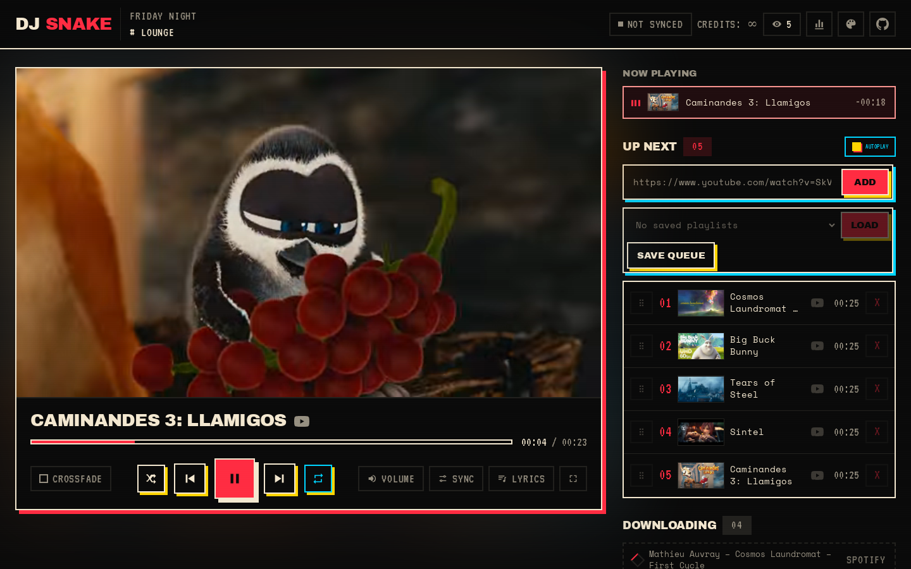
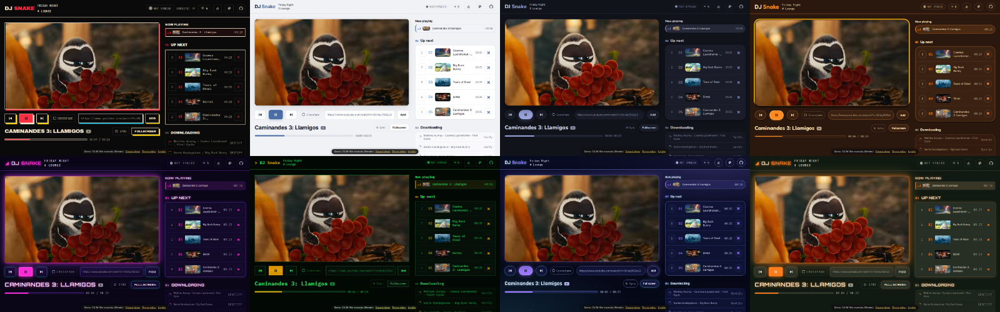

# The clip page

When the bot joins voice it posts a link such as `https://dj.example.com/<session>` and keeps a status message in that text channel. The clip page is a web page that shows the video of the current track, muted and in sync with the audio the bot plays in Discord.



On a phone the same page adapts to a narrow screen:

:::{image} ../screenshots/clip-page-mobile.png
:alt: The clip page on a phone
:width: 260px
:::

## What it does

The page shows the current video, the queue ("Up next"), a "Now playing" row, tracks still downloading, and a progress bar. It lets you:

- skip to the next track or go back (previous restarts the track if it has played for more than 5 seconds or there is no history);
- pause and resume;
- seek by clicking the progress bar;
- play a queued track now (jump);
- remove or reorder queued tracks by dragging;
- add YouTube or [Spotify](spotify.md) links;
- toggle crossfade;
- show the lyrics of the current track.

Web actions are applied exactly like Discord commands and are reflected in the status message. The header shows how many people have the page open and a chart button that opens the server's listening stats.

### Sync

The page polls the bot for its state and keeps the muted video aligned with the audio position, including pauses and seeks. When crossfade is on, the page cross-dissolves its two videos during an overlap; skips are an instant swap.

### Lyrics

The Lyrics button (next to Sync) shows the words of the current track over the bottom of the clip, and follows the clip into fullscreen. With synced lyrics, the line being sung is highlighted and scrolled into place, with a thin bar under it that runs out when the next line starts. Lyrics follow the same clock as the video, your Sync offset included, so if the clip matches what you hear, so do the words. When only plain lyrics exist they appear in a scrollable sheet; when none are found the page says so quietly. Your choice is remembered in your browser.

Lyrics come from [LRCLIB](https://lrclib.net), a free lyrics database that needs no account or key. The bot looks them up in the background as soon as a track is queued, so playback never waits. It searches for the artist and title from Spotify when the track came from a Spotify link, and otherwise parses the YouTube title ("Artist - Title", dropping tags such as "(Official Video)" or "ft. …", or using the channel name as the artist); the track's duration picks the right version. Found lyrics are cached in `DATA_DIR/lyrics/`. Set `LYRICS=0` to turn the feature off.

Timing can be off for music videos with a long intro that SponsorBlock does not cut, or for a different edit of the song than the one LRCLIB has.

### Listening stats

The chart button shows, for the last week, month or all time: top tracks and artists, the most skipped track, hours played, number of tracks and sessions, peak listeners, and a day-by-hour heatmap shown in your browser's time zone.

Stats are kept in `DATA_DIR/stats.db`. For each played track the bot records who asked for it (the Discord display name, or "page web" for links added on the page), how long it played, and whether it was skipped (left before 30 seconds of play), plus voice sessions and the peak number of listeners. The requester is stored but never shown on the page.

## Sessions

A session belongs to the server, not to a voice connection: it survives the bot leaving voice (end of queue, `!stop`, being kicked, `!reset`). A fresh join reuses the unexpired link, or creates a new one.

A session expires after `SESSION_IDLE_HOURS` (6 by default) without playback, voice presence, commands or web actions. Its downloaded files are then deleted, and the old link answers that the session is unknown. Run `!play` again for a fresh one.

When the queue runs out, the bot stays in voice for `IDLE_DISCONNECT_SECONDS` (300 by default) so a track added meanwhile plays at once without rejoining; the page stays usable. It leaves after 30 seconds if nobody is left in the channel.

## Exposing the page

The web server listens on `WEB_PORT`. Compose publishes it on `WEB_BIND`, which defaults to `127.0.0.1` (this machine only). To reach it from elsewhere, put a reverse proxy or a tunnel in front, and set `PUBLIC_BASE_URL` to the public address so the posted link is correct.

```
# Caddyfile
dj.example.com {
    reverse_proxy 127.0.0.1:47823
}
```

```bash
# or a Cloudflare Tunnel, then PUBLIC_BASE_URL=https://dj.example.com
cloudflared tunnel --url http://127.0.0.1:47823
```

```{warning}
Anyone who has the link can control the queue. Treat it as a secret and share it only with people you trust.
```

## Themes



The page has eight preset themes: `arcade` (the default look), `minimal`, `night`, `vinyl`, `club`, `terminal`, `space` and `cobalt` (a flat ultramarine page with blush-pink controls and wide type). A ninth, `custom`, is built from three colors (background, text, accent) on top of a preset's fonts and shapes.

Viewers can switch theme for themselves with the palette button in the page header. That choice stays in their browser. The custom theme can only be edited by an admin through the editor.

### Setting the server default

Members with the **Manage Server** permission use these commands:

- `!theme` shows the current theme and the presets.
- `!theme <preset>` sets the default for the server.
- `!theme reset` goes back to `WEB_THEME` and drops the custom colors, name and logo.

Servers that never ran `!theme` use the `WEB_THEME` environment variable.

### The theme editor and logos

`!theme edit` sends you, by direct message, a private link to the page's theme editor. The link is valid for 30 minutes and is tied to your server, so do not share it. If the server has no live session, one is opened without the bot joining voice. In the editor you can:

- pick the default theme;
- build a `custom` palette from background, text and accent colors, starting from the fonts and shapes of a preset;
- set a community name (up to 32 characters) shown instead of "DJ Snake";
- upload a logo: PNG, JPEG, WebP or GIF, 512 KB at most (SVG is not accepted).

Themes and logos are stored in `DATA_DIR` (`./data` with Compose), so they survive restarts and rebuilds. The container runs as UID 1000, which must be able to write that directory.
